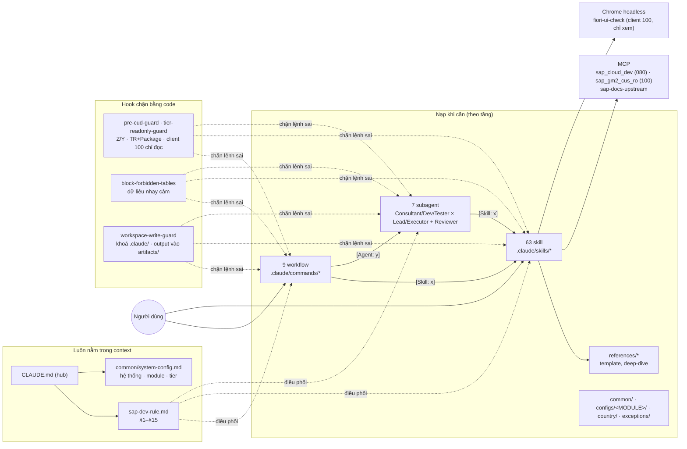

# ABAP Cloud AI — Workspace Claude Code


Workspace lập trình cặp với Claude Code trên **SAP S/4HANA Cloud Public Edition** (ABAP Cloud, Clean Core). Claude làm việc như một developer SAP có kỷ luật: đi từ FS tới code đã activate, tự kiểm tra dữ liệu và giao diện trên hệ thống thật, ghi mọi kết quả vào hồ sơ của từng báo cáo/chức năng, và bị hook chặn cứng ở những thao tác rủi ro.

| Thành phần | Số lượng | Vai trò |
|---|---|---|
| Skill | 63 | Tự kích hoạt khi mô tả khớp yêu cầu: 45 skill kỹ thuật ABAP Cloud, 18 skill nghiệp vụ SAP Public Cloud |
| Workflow | 9 | Slash command: phân tích FS, build report / app, sửa lỗi, API, phân tích và review code |
| Subagent | 7 | Consultant / Dev / Tester (mỗi nhóm có Lead và Executor) + `reviewer-lead` duyệt độc lập |
| Module | 11 | Tầng tham chiếu Public Cloud: SD, FI, CO, MM, PP, QM, PM, PS, TM, EWM, TR |
| Hook | 11 | Chặn bằng code: chỉ object Z/Y, bắt buộc package/TR, client 100 chỉ đọc, dữ liệu nhạy cảm, khoá `.claude/` |

**Hệ thống đang dùng** — hai tenant S/4HANA Public Cloud, cả hai là DEV:
- Client **080** (`sap_cloud_dev`): nơi duy nhất được ghi object. User dev không có quyền đọc dữ liệu ở đây.
- Client **100** (`sap_gm2_cus_ro`): chỉ đọc, test, debug — mọi kiểm tra dữ liệu và giao diện chạy ở đây.
- Quốc gia Việt Nam. Chat tiếng Việt, code và tên định danh tiếng Anh.

---

## 🧭 Kiến trúc tổng quan

```mermaid
flowchart LR
    FS["📄 FS<br/>artifacts/targets/&lt;TARGET&gt;/fs/"] --> A{"Cần Z-table<br/>mới?"}
    A -->|"không — dữ liệu có trong CDS released"| FA["/sap-dev-fs-analytic"]
    A -->|"có — app hoàn toàn mới"| FAT["/sap-dev-fs-analytic-transactional-app"]
    FA --> TS["📋 TS + Verify Loop<br/>(tối đa 3 vòng)"]
    FAT --> TS
    TS --> G1{{"👤 Người duyệt TS"}}
    G1 --> CR["/sap-dev-create-report"]
    G1 --> CTA["/sap-dev-create-transactional-app"]
    CR --> BUILD["Build RAP tuần tự<br/>mỗi object: Lint → kiểm released → Activate<br/>→ activation-guard 4 gate"]
    CTA --> BUILD
    BUILD --> SV["🧪 Phase 2 tự kiểm trên client 100<br/>data: case dương / âm / biên<br/>UI: metadata + chạy app thật VI/EN"]
    SV --> G2{{"👤 Phần còn lại người dùng kiểm<br/>action đổi dữ liệu, in ấn — tối đa 3 vòng"}}
    G2 --> LOG["📒 Ghi mọi case vào hồ sơ<br/>handbook.json → sổ tay báo cáo"]
    LOG --> RV{"🔍 reviewer-lead duyệt độc lập<br/>(Phase 2.5, tối đa 3 vòng)"}
    RV -->|"APPROVE"| WT["📦 Walkthrough + báo cáo rủi ro"]
    RV -->|"CHANGES_REQUIRED<br/>sửa trong phạm vi TS"| BUILD
    RV -->|"BLOCK"| STOP{{"👤 Dừng, hỏi người dùng"}}
```





---

## 🚀 Bắt đầu

### Cài đặt lần đầu

1. Mở thư mục này bằng **Claude Code**.
2. **Windows:** hook là script Bash, cần Git for Windows cùng `jq` và `python` trên PATH. Thiếu `jq` thì 4 hook chặn sẽ **chặn luôn** (fail closed) — xem mục Hook. Kiểm tra UI tự động cần thêm **Node ≥ 22** và **Google Chrome** (đường dẫn mặc định `C:/Program Files/Google/Chrome/Application/chrome.exe`).
3. Tạo `.mcp.json` từ `.mcp.json.example`:
   - `sap_cloud_dev`: `tools/vsp/vsp.exe` trỏ client 080, cookie `tools/vsp/cookies_dev.txt`.
   - `sap_gm2_cus_ro`: `tools/vsp/vsp.exe` trỏ client 100, cookie `tools/vsp/cookies_cus.txt`.
   - `sap-docs-upstream`: tra tài liệu SAP và trạng thái release của object.

   Mỗi tenant một file cookie riêng. Không commit `.mcp.json`, `vsp.exe` hay file cookie.
4. **Lấy cookie:** `vsp.exe --browser-auth … --cookie-save tools/vsp/cookies_<dev|cus>.txt`, đăng nhập SSO trên Chrome (nên đóng Chrome trước). Restart VS Code để server MCP đọc cookie mới, rồi chạy `bash .claude/scripts/sap-doctor.sh` (hoặc nói với Claude "kiểm tra workspace"): cookie từng tenant, tool, hook, integrity phải PASS hết.
5. Đọc FS cần venv MarkItDown: `python -m venv .venv_markitdown` rồi `.venv_markitdown\Scripts\pip install "markitdown[all]"`. PDF / PPTX / HTML đi qua MarkItDown; **DOCX / XLSX đi qua `.claude/scripts/office_to_md.py`** trong cùng venv (giữ ảnh nhúng, giữ mã SAP có số 0 đầu). File `.doc` cũ hoặc docx có mật khẩu: mở Word, Save As `.docx` trước.
6. Bỏ FS vào `artifacts/targets/<TARGET>/fs/`.
7. **Khoá `.claude/`:** muốn sửa rule/skill/hook thì **người dùng** tự tạo file rỗng `.claude/.unlock` (agent không bao giờ được tạo file này). Sửa xong chạy `bash .claude/scripts/integrity-check.sh`, rồi xoá `.unlock`.

### 9 workflow

**Luồng A — báo cáo / màn hình trên dữ liệu CDS released có sẵn:**

```bash
# FS → Technical Specification
/sap-dev-fs-analytic artifacts/targets/<TARGET>/fs/<FS>.docx <TARGET>
# Duyệt artifacts/targets/<TARGET>/ts/TS.md, rồi TS → object RAP đã activate
/sap-dev-create-report <PACKAGE> <TR> artifacts/targets/<TARGET>/ts/TS.md
```

**Luồng B — app transactional hoàn toàn mới (chưa có Z-table/CDS):**

```bash
# FS → TS gồm cả thiết kế DDIC (bảng, domain, number range, status machine)
/sap-dev-fs-analytic-transactional-app artifacts/targets/<TARGET>/fs/<FS>.docx <TARGET>
# TS → DDIC + cây RAP đầy đủ + OData binding
/sap-dev-create-transactional-app <PACKAGE> <TR> artifacts/targets/<TARGET>/ts/TS.md
```

**Bảo trì, tích hợp, phân tích:**

```bash
/sap-dev-bug-fix <OBJECT> "<mô tả lỗi + dữ liệu mẫu>"       # tìm nguyên nhân + sửa an toàn, dừng chờ duyệt trước khi sửa
/sap-dev-api-inbound <API_NAME>                              # hệ thống ngoài gọi SAP, trên Z_API_FWK
/sap-dev-api-outbound <API_NAME>                             # SAP gọi hệ thống ngoài qua Z_API_FWK=>execute_api
/sap-dev-code-analysis <OBJECT|PACKAGE> "<trọng tâm>"        # phân tích sâu + tài liệu, chỉ đọc
/sap-dev-code-review <OBJECT> "<trọng tâm>"                  # review nghiêm ngặt, chỉ tư vấn
```

Trước khi đẩy object lên SAP, workflow build chạy `python -X utf8 .claude/scripts/released_check.py <bản nháp>`: mọi class / interface / CDS / BDEF / function module chuẩn trong bản nháp được tra trong danh sách SAP; object deprecated hay chưa released bị chặn ngay (kèm tên thay thế), không đợi tới ATC. Code tạo chứng từ SAP chuẩn (sales order, goods movement, journal entry…) theo `.claude/common/document-creation-pattern.md`: EML trên BDEF released trước, API chuẩn sau — BAPI cổ điển như `BAPI_GOODSMVT_CREATE` không released trên Public Cloud — và chống tạo trùng khi gọi lại.

Mọi workflow build đều hỏi lại thông tin còn thiếu (package, TR, chỗ hổng trong TS) trước khi động vào hệ thống. Không có bằng chứng activation thì không đánh dấu xong; activate được chưa có nghĩa là đúng.

### Phase 2 — kiểm tra chạy thật

Với `/sap-dev-create-report` và `/sap-dev-create-transactional-app`, Manager (phiên chính) tự kiểm phần lớn trên client 100. Người dùng chỉ kiểm phần máy không chứng minh được. Chuẩn so sánh luôn là **FS + TS**, không phải một checklist cố định.

| Bước | Ai làm | Nội dung |
|---|---|---|
| 2.0a | Manager | `fetch.sh samecode`: source trên 080 và 100 có giống nhau không. Khác nhau thì toàn bộ chuyển sang kiểm tay |
| 2.0b | Manager | Data qua OData bằng count assertion (chỉ in số dòng, không in giá trị). Mỗi rule TS §5 có case dương và âm, rule có ngưỡng thêm case biên, mỗi filter TS §2 có 2 case |
| 2.U | Manager | `ui_checklist.md` từ FS + TS (ID `UI-nn`). **Metadata:** `ui-check.js` so `$metadata` + DDLX — cột, thứ tự, label, filter, value help, action, facet; phần có trên màn mà spec không có là **thừa**. **Chạy thật (bước 4b):** `fiori-ui-check` (mục *Kiểm tra giao diện tự động* bên dưới) mở app bằng Chrome, đăng nhập **tiếng Việt và tiếng Anh**, gõ bộ lọc, mở value help, đọc cột / nút / object page, đánh giá theo kết quả và ảnh chụp |
| 2.M | Người dùng | Chỉ phần 2.U không chứng minh được: action làm đổi dữ liệu (Post, Save, Create…), in ấn / form, cấu hình chỉ có trong `manifest.json` khi app chưa deploy. Gửi screenshot, Manager đối chiếu |
| 2.3 | Manager | Ghi **mọi case** (`TC-nn` / `UI-nn` / `M-nn`) cùng mong đợi, thực tế, PASS/FAIL, evidence vào `handbook.json` của version đang build, rồi render sổ tay. Lần mới ở trên, không xoá lần cũ |

Script dùng chung: `.claude/scripts/odata-verify/fetch.sh` (samecode / srvurl / metadata / sample) và `ui-check.js` — chạy không tham số để xem hướng dẫn; chỉ gọi GET, lấy host và cookie từ `.mcp.json`.

**Lỗi đã gặp — error codex:** gặp lỗi (dump, popup, mã HTTP, exception), Claude tra `artifacts/system_analysis/ERROR_CODEX/` theo mã lỗi trước khi lần dấu từ đầu: `python -X utf8 artifacts/system_analysis/ERROR_CODEX/codex.py find "<mã lỗi>"`. Mỗi **nguyên nhân gốc** là một entry (mã lỗi, triệu chứng, cách sửa, `verified` + bằng chứng, các lần gặp). Sửa xong mà cùng nguyên nhân thì chỉ thêm một dòng `occurrences`, không tạo bản trùng (`codex.py check` báo trùng); gặp ≥ 3 lần ở các target thì Claude đề xuất phòng ngừa. Skill `sap-analyze-symptom` và `/sap-dev-bug-fix` làm việc này tự động.

`/sap-dev-bug-fix` ghi sổ tay theo cùng cách: `R-nn` tái hiện bug trước và sau khi sửa (trên data thật của client 100 khi được; lỗi nhìn thấy trên màn hình thì tái hiện bằng `fiori-ui-check`), `UT-nn` unit test theo ma trận dương / âm / biên, `REG-nn` hồi quy cho từng object phụ thuộc.

### Phase 2.5 — duyệt độc lập

1. Manager đọc lại source đang active của mọi object, lưu vào `final_source.md`.
2. `reviewer-lead` so bản build với TS và ledger, ghi kết luận vào `artifacts/targets/<TARGET>/build/review_verdict.md`.
3. **APPROVE** → walkthrough. **CHANGES_REQUIRED** → sửa trong phạm vi TS rồi duyệt lại (tối đa 3 vòng). **BLOCK** → dừng, hỏi người dùng; Manager không bao giờ tự vượt qua BLOCK.

---

## 🖥️ Kiểm tra giao diện tự động — `fiori-ui-check`

Skill mở app Fiori Elements (OData V4) trong **Chrome headless**, điều khiển qua DevTools Protocol bằng Node — không cần plug-in, không cần Playwright. Đăng nhập bằng cookie của client 100.

| Chế độ | Khi nào | Cách hoạt động |
|---|---|---|
| **App đã deploy** | Có BSP (`/sap/bc/ui5_ui5/sap/<app>/index.html`) | Mở đúng app thật |
| **Preview** | App chưa deploy, service binding đã publish | `preview_server.mjs` dựng app Fiori Elements tạm (List Report + Object Page) trên `127.0.0.1`, UI5 lấy từ `ui5.sap.com`, request `/sap/...` đi qua proxy kèm cookie — giống nút *Preview* của service binding trong ADT |

**Kiểm được:** value help có ra dữ liệu không, bộ lọc bắt buộc, kết quả tìm kiếm, cột và nhãn, nút trên toolbar (bật / tắt), object page, lỗi console, request hỏng, ảnh chụp từng bước. **Luôn chạy cả tiếng Việt và tiếng Anh** — value help Z dựng trên `DDCDS_CUSTOMER_DOMAIN_VALUE_T` lọc theo ngôn ngữ đăng nhập sẽ rỗng khi đăng nhập tiếng Việt nếu domain chỉ có text tiếng Anh.

**Chỉ đọc, chặn bằng code:** script không có bước nào bấm nút; bước JS tự viết có lệnh bấm / execute / create / delete bị từ chối; proxy ở chế độ preview chỉ cho GET và `$batch` toàn GET, còn lại trả 403. Test action làm đổi dữ liệu luôn cần người dùng đồng ý bằng văn bản.

**Không kiểm được ở chế độ preview:** cấu hình chỉ có trong `manifest.json` của app thật (cột cố định, variant mặc định, extension riêng, tile launchpad) — giữ `Proof: manual`.

```bash
# app đã deploy
node .claude/skills/fiori-ui-check/scripts/ui_check.mjs --url "https://<host>/sap/bc/ui5_ui5/sap/<app>/index.html?sap-client=100" \
     --cookies tools/vsp/cookies_cus.txt --out <thư mục tạm> --steps steps.json --langs VI,EN
# app chưa deploy (Git Bash: giữ nguyên đường dẫn /sap/...)
MSYS_NO_PATHCONV=1 node .claude/skills/fiori-ui-check/scripts/ui_check.mjs --service /sap/opu/odata4/sap/<binding>/srvd/sap/<srvd>/0001/ \
     --host https://<host> --client 100 --table GridTable --cookies tools/vsp/cookies_cus.txt --out <thư mục tạm> --steps steps.json --wait 30000
```

`steps.json` là danh sách bước khai báo, ví dụ `{"do":"value_help","field":"AllocationType"}`, `{"do":"fill","field":"CompanyCode","value":"1000"}`, `{"do":"go"}`, `{"do":"rows","props":["PostingDate"]}`, `{"do":"open_row","index":0}`. Ảnh chụp có số tiền nằm ở thư mục tạm ngoài workspace; chỉ ảnh không có số tiền / dữ liệu cá nhân mới được chép vào `artifacts/targets/<TARGET>/test/`.

Skill cũng chụp trang HTML cục bộ (sổ tay) để kiểm tra bố cục sau mỗi lần sửa renderer.

---

## 📒 Hồ sơ mỗi báo cáo / chức năng và sổ tay

**Một folder cho mỗi target** (rule §4, chi tiết `.claude/common/handbook-target.md`): `artifacts/targets/<TARGET>/` chứa `INDEX.md` (lối vào ~2 KB: trạng thái, câu hỏi mở, danh mục file), `handbook.json` (nguồn của trang sổ tay), `fs/`, `ts/`, `build/`, `forms/`, `ddlx/`, `analysis/`, `test/`, `notes/<chủ đề>.md` (bẫy đã gặp, quyết định ngoài spec — không để trong memory), `walkthrough*.md`.

**`handbook.json` tách hai loại ghi chép:**

| Mục | Ghi gì | Khi nào |
|---|---|---|
| `versions` | **Version của chính báo cáo / chức năng**: thay đổi, ATC trên mọi object của target, test case, preview, snapshot source | Chỉ khi code thay đổi: build, bug-fix, change request, hoặc phát hiện có người sửa ngoài workspace |
| `records` | **Lịch sử kiểm tra hồ sơ**, mỗi ngày một dòng: loại (phân tích, preview, test lại…), áp dụng cho version nào, những gì đã kiểm tra, test, ATC | Mọi lần kiểm tra không đổi code. Cùng ngày kiểm tra nhiều lần thì gộp vào dòng của ngày đó |

**Mỗi lần đụng tới target đã có** chạy `target-refresh`: kéo source mọi object Z từ SAP, `drift_check.py` so với snapshot mới nhất (ở version hoặc ở ngày kiểm tra). Ai đó sửa trong ADT mà workspace không biết → ghi thành version riêng kèm nội dung thay đổi thật, rồi mới làm việc mới. Cuối mỗi lần là bảng preview 7 mục có bằng chứng: chạy thử (data + UI), ATC toàn target, object, snapshot, INDEX, notes, render sổ tay.

**Hai sổ tay tách riêng, không link qua lại** (cả hai chỉ nằm trên máy):

| Sổ tay | Thư mục | Nội dung |
|---|---|---|
| Báo cáo / chức năng | `artifacts/handbook_targets/` | Sinh hoàn toàn từ `handbook.json`: trang chủ có thẻ cho từng target; mỗi target một trang (mục đích, sơ đồ object, form, version, ATC, preview, kiểm thử, lịch sử kiểm tra) với hàng nút chuyển mục; mỗi ngày kiểm tra một trang chi tiết riêng |
| Workspace | `artifacts/handbook/` | Viết tay: MCP, catalog CDS, tiến độ dựng workspace, nhật ký bảo trì |

```bash
python .claude/scripts/handbook/render_target.py <TARGET>     # hoặc --all
python .claude/scripts/handbook/drift_check.py <TARGET> [--record <version> | --record-date today]
```

Không sửa tay trang sinh ra; không ghi dữ liệu nghiệp vụ vào `handbook.json` (chỉ số dòng, tên field, kết quả).

---

## 📂 Cấu trúc thư mục

```text
WORK_SPACE/
├── CLAUDE.md                        # 🧠 File hub, luôn nạp; @import rule + system-config
├── README.md                        # 📖 File này
├── .mcp.json.example                # Mẫu cấu hình MCP (file thật .mcp.json không commit)
├── tools/vsp/                       # vsp.exe (MCP server ADT) + cookie mỗi tenant (không commit)
├── .claude/
│   ├── rules/sap-dev-rule.md        # 🛡️ Rule §1–§15, luôn nạp
│   ├── common/                      # 🧩 Tầng tham chiếu dùng chung
│   │   ├── system-config.md         #   Tier 1: hệ thống, 11 module, country, tier, blocklist, server ghi/đọc
│   │   ├── context-loading-protocol.md  # 4 tầng nạp context
│   │   ├── cloud-abap-constraints.md    # Câu lệnh cấm + API thay thế
│   │   ├── decision-ladder.md       #   Dùng lại trước khi tạo mới (+ 5a–5d khi object chưa released)
│   │   ├── document-creation-pattern.md # Tạo chứng từ SAP chuẩn: thứ tự interface, 9 bước, chống trùng
│   │   └── handbook-target.md       #   Layout folder target + schema handbook.json (versions / records)
│   ├── configs/<MODULE>/            # 📘 Kiến thức Public Cloud của 11 module
│   ├── country/vn.md                # 🇻🇳 Bản địa hoá Việt Nam
│   ├── exceptions/                  # 🚫 Blocklist dữ liệu nhạy cảm (profile standard)
│   ├── skills/<name>/SKILL.md       # 📚 63 skill (+ references/, scripts/ khi cần)
│   ├── agents/<team>-<layer>.md     # 🤖 7 subagent
│   ├── commands/                    # ⚙️ 9 workflow dạng slash command
│   ├── hooks/                       # 🔒 11 hook (bảng bên dưới)
│   ├── scripts/integrity-check.sh   # ✅ Kiểm tra toàn vẹn sau mọi thay đổi .claude/
│   ├── scripts/odata-verify/        # 🧪 fetch.sh + ui-check.js: kiểm data / UI qua OData (chỉ đọc)
│   ├── scripts/handbook/            # 📒 render_target.py (sổ tay) · drift_check.py (sửa ngoài workspace)
│   ├── scripts/office_to_md.py      # 📄 FS docx/xlsx → Markdown (giữ ảnh, giữ mã SAP)
│   ├── scripts/released_check.py    # 🔎 Bản nháp có dùng object chưa released / deprecated không
│   ├── scripts/sap-doctor.sh        # 🩺 Sức khỏe workspace: tool, cookie 080/100, hook, integrity, .unlock
│   ├── scripts/z_catalog/           # 🗃️ build_z_catalog.py: kho object Z dùng lại (quét qua ADT, chỉ đọc)
│   └── settings.json                # Đăng ký hook + thư mục memory
└── artifacts/                       # 📦 Mọi output (🔒 = chỉ trên máy, không đưa lên git)
    ├── targets/<TARGET>/            #   MỌI THỨ của 1 báo cáo/chức năng (fs/ 🔒; xem mục Hồ sơ)
    ├── handbook_targets/ 🔒         #   Sổ tay báo cáo / chức năng (sinh tự động)
    ├── handbook/ 🔒                 #   Sổ tay workspace
    ├── documents/ 🔒                #   UM tool, naming convention, tài liệu SAP
    ├── system_analysis/CDS_RELEASED_CATALOG/  # 7.893 CDS view released chia theo module
    ├── system_analysis/SAP_RELEASE_WATCH/     # Theo dõi SAP phát hành gì mới
    ├── system_analysis/Z_OBJECT_CATALOG/ 🔒   # Kho object Z/Y của dự án theo package
    ├── system_analysis/ERROR_CODEX/           # Lỗi đã gặp, tra theo mã lỗi (codex.py find)
    └── scratchpads/_session/        #   Snapshot của hook pre-compact
```

---

## 🧩 Tầng tham chiếu và cách nạp context

Claude chỉ nạp những gì task cần, chia 4 tầng (rule §15, `common/context-loading-protocol.md`):

| Tầng | Khi nào | Nạp gì |
|---|---|---|
| 1 | Luôn luôn | `sap-dev-rule.md` + `common/system-config.md` |
| 2 | Theo vai subagent | Consultant: README của **module mà FS đụng tới**. Dev/Tester: `cloud-abap-constraints.md` |
| 3 | Khi có điều kiện kích hoạt | Viết/review ABAP → `cloud-abap-constraints.md`; đọc dữ liệu → `exceptions/README.md`; làm FS/TS của module → `configs/<MODULE>/` |
| 4 | Theo từng task | Kit do workflow/skill chỉ định (`references/`, mục TS, dòng ledger) |

**11 module** trong `configs/`: mỗi module có README ghi object released để đọc (CDS), ghi (RAP BO qua EML) và mở rộng (BAdI), kèm bẫy đã biết — ví dụ `I_PurchaseOrder` không released, phải dùng `I_PurchaseOrderAPI01`; PS trên Public Cloud là Enterprise Projects. Chỗ nào chưa kiểm chứng đều đánh dấu *unverified*.

**Blocklist dữ liệu** (`exceptions/`, profile `standard`):
- **Chặn hẳn:** dữ liệu cá nhân của khách hàng / nhà cung cấp / BP, địa chỉ, ngân hàng, user và quyền, HR, mã số thuế, giá và điều kiện giá.
- **Hỏi người dùng trước:** chứng từ bán hàng, giao hàng, hoá đơn, mua hàng, kế toán.

Đọc metadata (DDLS, danh sách field) luôn được phép.

---

## 🔒 Hook — chặn bằng code

Rule trong prompt có thể bị bỏ qua, hook thì không.

| Hook | Khi nào chạy | Làm gì |
|---|---|---|
| `pre-cud-guard.sh` | Trước mọi lệnh MCP SAP | Chỉ sửa object Z/Y; create/delete phải có package và TR; package trong `ZLOCAL` hoặc `$TMP` miễn TR (`LOCAL_NO_TR_PACKAGES`); agent không được tạo / sửa / xoá TR |
| `tier-readonly-guard.sh` | Trước mọi lệnh MCP SAP | Chặn create/edit/delete trên client 100 và trên mọi server có `SAP_CLIENT` không thuộc `WRITE_CLIENTS` (080), không rõ client cũng chặn; TR qua `system` luôn chặn; `execute_abap` chặn trên 100, hỏi trên 080; `debug` hỏi trên 080; `SAP_TIER` khác DEV thì chặn mọi thao tác ghi |
| `block-forbidden-tables.sh` | Trước MCP `query` và Bash `datapreview` | So SQL với `exceptions/`: nhóm cấm → chặn, nhóm nhạy cảm → hỏi |
| `sap-edit-fact-gate.sh` | Trước `edit` / `delete` | Lần đầu sửa / xoá một object bị chặn đến khi agent nêu object phụ thuộc và căn cứ (dòng TS / yêu cầu của người dùng) |
| `workspace-write-guard.sh` | Trước Write / Edit / Bash | Khoá `.claude/` (chỉ mở khi **người dùng** tạo `.claude/.unlock`); file mới phải nằm trong `artifacts/` |
| `activation-verify.sh` | Sau khi ghi object trên 080 | Nhắc chạy đủ 4 gate của activation-guard |
| `session-start.sh` | Mở / resume / sau compact | Tóm tắt cấu hình, cảnh báo nếu `.unlock` còn, chỉ ledger/handoff gần nhất, kiểm tra SAP có phát hành gì mới |
| `verify-subagent-output.sh` | Khi subagent của team dừng | Tin nhắn cuối phải nêu file có thật, không rỗng trong `artifacts/` (hoặc `OUTPUT: none`) |
| `target-refresh-remind.sh` | Khi người dùng gửi prompt | Nhắc tên một target đã có `handbook.json` → nhắc chạy `target-refresh` trước |
| `pre-compact.sh` | Trước compact | Ghi snapshot trạng thái vào `artifacts/scratchpads/_session/`, nhắc handoff |
| `report-language-guard.sh` | Khi agent kết thúc lượt | Kết luận kiểu "should work", "chắc là chạy" (rule §8) → bắt làm tiếp một lần để thay bằng bằng chứng |

4 hook chặn (`pre-cud-guard`, `tier-readonly-guard`, `workspace-write-guard`, `block-forbidden-tables`) cần `jq`; thiếu `jq` thì chặn (fail closed) trong phạm vi của từng hook, Bash thường vẫn chạy để cài lại `jq`. Hook đảm bảo "việc đó có xảy ra hay không"; "làm có tốt không" vẫn do rule quyết định.

---

## 🔄 Theo dõi SAP phát hành gì mới

Khi chọn object để dùng (CDS view, class, BDEF, API, event, BAdI), Claude tra danh sách chính thức của SAP chứ không đoán, và danh sách đó tự cập nhật.

| Nguồn | Nội dung | Lưu ở |
|---|---|---|
| Cloudification Repository (`SAP/abap-atc-cr-cv-s4hc`), cũng là danh sách ATC dùng | ~37.000 object dùng được trong ABAP Cloud (mọi loại: class, interface, BDEF, BAdI, function module…), trạng thái released / deprecated, object thay thế, mô tả — nguồn của `released_check.py` | `SAP_RELEASE_WATCH/released_objects/` |
| SAP Business Accelerator Hub (gói Public Edition) | API OData / SOAP / REST, business event, BAdI, BO interface, CDS | `SAP_RELEASE_WATCH/api_hub/` |
| Danh sách CDS ở trên, chia theo module | 7.893 CDS view released, mô tả đọc từ 080, view deprecated kèm view thay thế | `CDS_RELEASED_CATALOG/` (đọc `INDEX.md` trước) |
| SAP Help — What's New | Tính năng mới, app bị gỡ theo release | `SAP_RELEASE_WATCH/whats_new/<release>.md` |

Mỗi lần mở phiên, `session-start.sh` chạy `refresh_sap_release_watch.py --check` (~2 giây, không có gì mới thì im lặng). Có thay đổi thì Claude refresh, dựng lại catalog CDS, ghi `changelog.md` và báo lại. Chạy tay:

```bash
python -X utf8 artifacts/system_analysis/SAP_RELEASE_WATCH/refresh_sap_release_watch.py --check   # chỉ so ngày
python -X utf8 artifacts/system_analysis/SAP_RELEASE_WATCH/refresh_sap_release_watch.py           # cập nhật nếu có mới
python -X utf8 artifacts/system_analysis/SAP_RELEASE_WATCH/refresh_sap_release_watch.py --force   # quét lại hết
```

Mô tả object mới đọc trên 080, cần cookie `cookies_dev.txt` còn sống; cookie hết hạn thì refresh vẫn chạy, chỉ thiếu mô tả.

---

## 📚 Danh mục skill (63)

**🔎 Phân tích FS / Consultant (10):**
- `ask-consultant`: hỏi nhanh nghiệp vụ một module, trả lời theo cấu hình workspace, có nguồn từng ý, chỉ đọc.
- `package-to-process`: tài liệu quy trình nghiệp vụ từ một package Z (Mermaid, bảng từng bước, object thuộc bước nào).
- `sap-analyze-symptom`: phân tích lỗi runtime (dump, trace, object inactive, where-used) chỉ đọc, ra nguyên nhân có bằng chứng rồi chuyển `/sap-dev-bug-fix`.
- `fs-data-model-extractor`: data model từ FS, thiết kế Z-table.
- `fs-fiori-ui-elements-mapper`: layout FS → annotation Fiori Elements.
- `fs-logic-behavior-translator`: quy tắc nghiệp vụ → CDS / virtual element / behavior pool.
- `fs-integration-api-analyzer`: đặc tả tích hợp → thiết kế API.
- `fs-vision-extractor`: chép lại mockup, ảnh chụp trong FS.
- `document-markdown-converter`: FS nhị phân → Markdown.
- `find-released-cds-view`: tìm CDS released cho một field nghiệp vụ.

**🌐 Kiến thức quy trình SAP (18)**, họ `sap-process-<mảng>-<quy trình>`; mỗi skill có `SKILL.md` gọn và `references/deep-dive.md` chỉ đọc khi FS cần đi sâu.
- **O2C**: `sell-from-stock` (BD9) · `customer-returns` (BKP) · `down-payment-billing` (7S7)
- **Supply Chain**: `atp` (2LN) · `warehouse-mgmt` · `inventory-mgmt` (BMC)
- **Manufacturing**: `discrete-execution` (BJ5) · `process-execution` (BJ8) · `repetitive-execution` (BJH)
- **Production**: `discrete-planning` · `process-planning` · `repetitive-planning`
- **Finance**: `general-ledger` (J58) · `financial-close` (J58) · `asset-accounting` (J62)
- **Project System**: `customer-project` (J11) · `internal-project` (1A8) · `resource-mgmt` (1KC)

**🧱 Nền tảng ABAP Cloud (11):** `abap` (abaplint + Clean ABAP) · `abap-cloud` (3 tier, giới hạn ngôn ngữ) · `abap-cloud-migration` · `atc-cloudification` · `ddic-foundation` · `modern-abap-syntax` · `abap-sql-amdp` · `abap-unit-testing` · `oo-design-patterns` · `released-abap-classes` · `abap-generative-ai`.

**⚙️ RAP & Service (8):** `rap` (BDEF, EML, handler, draft) · `rap-query-provider` (custom entity) · `rap-business-events` · `cds-view-entities` · `cds-analytical-views` · `cds-virtual-element` · `odata` · `badi-enhancement`.

**🧾 Form (2):**
- `excel-form-template`: FS → template Excel cho tool FIS Export Excel (`ZCL_EXPORT_EXCEL_XLSX`) + từ điển field + ABAP TYPES; lint template theo luật parser.
- `pdf-form-template`: form in trong FS → Adobe form `.xdp` có binding + XML mẫu; kiểm tra binding tự động.

**🔐 Nền tảng & bảo mật (4):** `authorization-iam` · `btp-abap-environment` · `btp-diagram-generator` · `sap-fiori-apps-reference`.

**🧭 Quản trị & năng suất (10):**
- `sap-doctor`: sức khỏe workspace (tool, cookie từng tenant, hook, integrity, `.unlock`) + cách refresh cookie.
- `fiori-ui-check`: kiểm tra giao diện app Fiori bằng Chrome headless, app đã deploy hoặc chế độ preview, VI + EN, chỉ xem (mục riêng ở trên).
- `target-refresh`: mỗi lần đụng tới target đã có — so source với snapshot, ghi thay đổi ngoài workspace thành version riêng, preview đầy đủ cuối mỗi lần.
- `z-object-catalog`: kho object Z/Y theo package; tra trước khi tạo mới để khỏi trùng.
- `activation-guard`: **4 gate** sau mỗi lần ghi object (log activation, trạng thái active, ảnh hưởng dây chuyền, 0 lỗi ATC mới).
- `naming-convention`: chuẩn đặt tên theo sheet của dự án (CDS/RAP `Z<prefix>_<module>_<tcode>`, service `ZUI_` / `ZAPI_` + `_O2` / `_O4`, bảng `ZA_` / `ZD_`, package `ZFPT_*`…).
- `scratchpad` (kế hoạch + ledger) · `handoff` (chuyển phiên) · `grill-me` (làm rõ yêu cầu) · `caveman` (chat ngắn gọn).

---

## 🤖 Subagent

Workflow gọi subagent qua `[Agent: y]` để phân tích và soạn nháp độc lập:

| Nhóm | Lead (opus, cần phán đoán) | Executor (sonnet, theo template) |
|---|---|---|
| Consultant | `consultant-lead`: dịch FS / code thành phát hiện kỹ thuật | `consultant-executor`: tiền xử lý (convert FS, chép ảnh, quét object) |
| Dev | `dev-lead`: logic behavior pool, class hỗ trợ | `dev-executor`: DDIC / CDS / BDEF / projection theo TS |
| Tester | `tester-lead`: kịch bản test, đánh giá rủi ro | `tester-executor`: khung ABAP Unit, quét pattern |
| Reviewer | `reviewer-lead`: duyệt độc lập build so với TS (Phase 2.5), kết luận APPROVE / CHANGES_REQUIRED / BLOCK, chỉ đọc | — |

Chỉ phiên chính (Manager) mới được ghi vào SAP. Subagent chỉ soạn nháp vào `artifacts/targets/<TARGET>/build/` và không bao giờ đánh dấu DONE; Manager đọc file của subagent trước khi push, activate và chạy activation-guard.

---

## ⚙️ Ghi chú cho developer

- **Thêm skill:** tạo `.claude/.unlock`, thêm `.claude/skills/<name>/SKILL.md` với `name` (trùng tên thư mục) và `description`; thân gọn, nội dung nặng vào `references/`, script vào `scripts/`. Chạy `bash .claude/scripts/integrity-check.sh` rồi xoá `.unlock`.
- **Package mới dưới `ZLOCAL`:** thêm tên vào `LOCAL_NO_TR_PACKAGES` trong `.claude/common/system-config.md` (hook chỉ thấy tên package, không biết package cha); chưa thêm thì hook đòi TR.
- **Thêm module:** tạo `.claude/configs/<MODULE>/README.md` **trước**, rồi mới thêm vào `SAP_ACTIVE_MODULES`; ngược thứ tự thì integrity check báo FAIL.
- **Kho object Z:** `python .claude/scripts/z_catalog/build_z_catalog.py ZFPT` quét package (đệ quy, chỉ đọc) vào `Z_OBJECT_CATALOG/`; quét lại sau mỗi lần build xong một target.
- **Sửa giao diện sổ tay:** render lại rồi chụp kiểm tra bằng `fiori-ui-check` (chế độ trang HTML) trước khi coi là xong.
- **Memory** nằm ngoài repo (`~/.claude/auto-memory/Work_space`), chỉ chứa sở thích, feedback, tham chiếu chung. Trạng thái task để trong ledger/handoff; kiến thức theo target để trong `notes/`.
- **Ignore:** quy tắc ignore nằm ở `.git/info/exclude` của máy đang dùng. Clone sang máy khác cần tạo `.gitignore` bỏ qua:
  - bí mật và file máy: `.mcp.json`, `tools/vsp/cookies*.txt`, `tools/vsp/vsp.exe`, `.venv*/`, `.claude/.unlock`, `.claude/settings.local.json`;
  - **tài liệu khách hàng và thông tin cá nhân — không bao giờ push:** `artifacts/handbook/`, `artifacts/handbook_targets/`, `artifacts/documents/`, `artifacts/targets/*/fs/`, `artifacts/targets/*/forms/logo_*`, `artifacts/targets/*/forms/*_data.xml`, `artifacts/targets/*/forms/*.spec.json`, `artifacts/system_analysis/Z_OBJECT_CATALOG/`; nên thêm `artifacts/targets/*/build/snapshot/` (source của khách hàng) và `artifacts/targets/*/test/` (ảnh chụp app).

  Vì vậy clone repo về sẽ **không có** sổ tay, UM, naming convention, FS và hồ sơ target; các file đó chỉ nằm trên máy làm việc.
