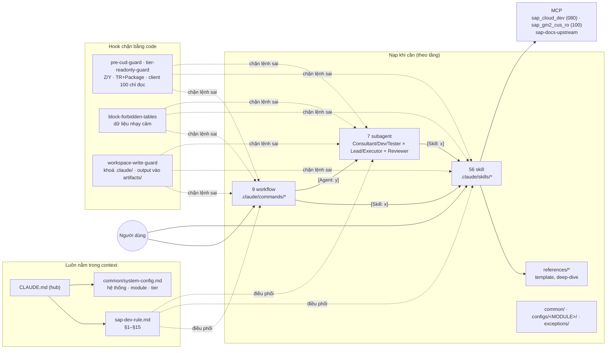

# ABAP Cloud AI — Workspace Claude Code


Workspace lập trình cặp với Claude Code trên **SAP S/4HANA Cloud Public Edition** (ABAP Cloud, Clean Core). Claude làm việc như một developer SAP có kỷ luật:

- **56 skill** tự kích hoạt khi mô tả khớp với yêu cầu: 38 skill kỹ thuật ABAP Cloud và 18 skill nghiệp vụ SAP Public Cloud.
- **9 workflow** dạng slash command, đi từ FS tới code đã activate.
- **7 subagent**: 3 nhóm Consultant / Dev / Tester (mỗi nhóm có Lead và Executor) và `reviewer-lead` duyệt độc lập trước khi đóng build.
- **Tầng tham chiếu cho 11 module**, cộng blocklist dữ liệu nhạy cảm.
- **Rule luôn nạp** giữ kỷ luật Clean Core.
- **Hook** chặn cứng các thao tác rủi ro nhất bằng code, không chỉ dặn trong prompt.

**Hệ thống đang dùng:**
- Hai tenant S/4HANA Public Cloud, cả hai đều là DEV:
  - Client **080**: nơi duy nhất được ghi object.
  - Client **100**: chỉ đọc, test, debug.
- Quốc gia: Việt Nam. Ngôn ngữ: chat tiếng Việt, code tiếng Anh.

---

## 🧭 Kiến trúc tổng quan

```mermaid
flowchart LR
    FS["📄 Tài liệu FS<br/>artifacts/targets/&lt;TARGET&gt;/fs/"] --> A{"Cần Z-table<br/>mới?"}
    A -->|"không — dữ liệu có trong CDS released"| FA["/sap-dev-fs-analytic"]
    A -->|"có — app hoàn toàn mới"| FAT["/sap-dev-fs-analytic-transactional-app"]
    FA --> TS["📋 TS + Verify Loop<br/>(tối đa 3 vòng)"]
    FAT --> TS
    TS --> G1{{"👤 Người duyệt TS"}}
    G1 --> CR["/sap-dev-create-report"]
    G1 --> CTA["/sap-dev-create-transactional-app"]
    CR --> BUILD["Build RAP tuần tự<br/>mỗi object: Lint → Activate<br/>→ activation-guard 4 gate"]
    CTA --> BUILD
    BUILD --> SV["🧪 Phase 2 tự kiểm trên client 100<br/>data: case dương / âm / biên<br/>UI: checklist từ FS + TS"]
    SV --> G2{{"👤 Phần kiểm tay còn lại<br/>F4, hiển thị, action — tối đa 3 vòng"}}
    G2 --> LOG["📒 Ghi mọi case vào sổ tay<br/>artifacts/handbook/&lt;target&gt;.html"]
    LOG --> RV{"🔍 reviewer-lead duyệt độc lập<br/>(Phase 2.5, tối đa 3 vòng)"}
    RV -->|"APPROVE"| WT["📦 Walkthrough + báo cáo rủi ro<br/>artifacts/targets/&lt;TARGET&gt;/"]
    RV -->|"CHANGES_REQUIRED<br/>sửa trong phạm vi TS"| BUILD
    RV -->|"BLOCK"| STOP{{"👤 Dừng, hỏi người dùng"}}
```





---

## 📂 Cấu trúc thư mục

```text
WORK_SPACE/
├── CLAUDE.md                        # 🧠 File hub, luôn nạp; @import rule + system-config
├── README.md                        # 📖 File này
├── .mcp.json.example                # Mẫu cấu hình MCP (file thật .mcp.json không commit)
├── tools/vsp/                       # vsp.exe (MCP server ADT) + cookie mỗi tenant (không commit)
├── .claude/
│   ├── rules/sap-dev-rule.md        # 🛡️ Rule §1–§15, luôn nạp
│   ├── common/                      # 🧩 Tầng tham chiếu dùng chung
│   │   ├── system-config.md         #   Tier 1: hệ thống, 11 module, country, tier, blocklist, server ghi/đọc
│   │   ├── context-loading-protocol.md  # 4 tầng nạp context
│   │   └── cloud-abap-constraints.md    # Câu lệnh cấm + API thay thế (đã tra kho release SAP)
│   ├── configs/<MODULE>/            # 📘 Kiến thức Public Cloud của 11 module: CDS / RAP BO / BAdI released
│   ├── exceptions/                  # 🚫 Blocklist dữ liệu nhạy cảm (profile standard)
│   ├── skills/<name>/SKILL.md       # 📚 56 skill (+ references/ nạp khi cần)
│   ├── agents/<team>-<layer>.md     # 🤖 7 subagent
│   ├── commands/                    # ⚙️ 9 workflow dạng slash command
│   ├── hooks/                       # 🔒 7 hook (xem bảng bên dưới)
│   ├── scripts/integrity-check.sh   # ✅ Kiểm tra toàn vẹn sau mọi thay đổi .claude/
│   ├── scripts/odata-verify/        # 🧪 fetch.sh + ui-check.js: tự kiểm data/UI qua OData (chỉ đọc)
│   ├── scripts/handbook/            # 📒 render_target.py: handbook.json → trang sổ tay
│   └── settings.json                # Đăng ký hook + thư mục memory
└── artifacts/                       # 📦 Mọi output (🔒 = chỉ trên máy, không đưa lên git)
    ├── targets/<TARGET>/            #   MỌI THỨ của 1 báo cáo/chức năng
    │   ├── INDEX.md · handbook.json #   lối vào · nguồn trang sổ tay
    │   ├── fs/ 🔒 ts/ build/ forms/ #   FS khách hàng · TS · ledger/nháp/verify · form (.xdp/.xlsx lên git; spec, data mẫu, logo 🔒)
    │   └── ddlx/ test/ notes/ walkthrough*.md
    ├── documents/ 🔒                #   UM tool, naming convention, tài liệu SAP CDS
    ├── system_analysis/CDS_RELEASED_CATALOG/  # Catalog 4.025 CDS view released theo module
    ├── scratchpads/_session/        #   Snapshot của hook pre-compact
    └── handbook/ 🔒                 #   Sổ tay HTML cá nhân (mở index.html bằng double-click)
```

Quy ước đặt file (rule §4): **mỗi báo cáo/chức năng một folder** `artifacts/targets/<TARGET>/`, chi tiết ở `.claude/common/handbook-target.md`. `INDEX.md` là lối vào; `handbook.json` là nguồn của trang sổ tay (mục đích, sơ đồ object, form, version + ngày + thay đổi, ATC theo version, test case và kết quả), render bằng `python .claude/scripts/handbook/render_target.py <TARGET>`. Kiến thức riêng của target đó (bẫy đã gặp, quyết định ngoài spec) để trong `notes/<chủ đề>.md` cùng thư mục, không để trong memory.

---

## 🧩 Tầng tham chiếu và cách nạp context

Claude chỉ nạp những gì task cần, chia 4 tầng (rule §15, `common/context-loading-protocol.md`):

| Tầng | Khi nào | Nạp gì |
|---|---|---|
| 1 | Luôn luôn | `sap-dev-rule.md` + `common/system-config.md` |
| 2 | Theo vai subagent | Consultant: README của **module mà FS đụng tới**. Dev/Tester: `cloud-abap-constraints.md` |
| 3 | Khi có điều kiện kích hoạt | Viết/review ABAP → `cloud-abap-constraints.md`; đọc dữ liệu → `exceptions/README.md`; làm FS/TS của module → `configs/<MODULE>/` |
| 4 | Theo từng task | Kit do workflow/skill chỉ định (`references/`, mục TS, dòng ledger) |

**11 module** trong `configs/`: SD, FI, CO, MM, PP, QM, PM, PS, TM, EWM, TR. Mỗi module có README ghi object released để đọc (CDS), ghi (RAP BO qua EML) và mở rộng (enhancement spot / BAdI), kèm bẫy đã biết. Ví dụ bẫy:
- `I_PurchaseOrder` không released, phải dùng `I_PurchaseOrderAPI01`.
- `I_MaintenanceOrder` không released, phải dùng `I_MaintenanceOrderBasic`.
- PS trên Public Cloud là Enterprise Projects.

Chỗ nào chưa kiểm chứng đều được đánh dấu *unverified*.

**Blocklist dữ liệu** (`exceptions/`, profile `standard`):
- **Chặn hẳn:** dữ liệu cá nhân của khách hàng / nhà cung cấp / BP, địa chỉ, ngân hàng, user và quyền, HR, mã số thuế, giá và điều kiện giá.
- **Hỏi người dùng trước:** chứng từ bán hàng, giao hàng, hoá đơn, mua hàng, kế toán.

Chỉ đọc metadata (DDLS, danh sách field) thì luôn được phép.

---

## 🔒 Hook — chặn bằng code

Rule trong prompt có thể bị bỏ qua, hook thì không.

| Hook | Khi nào chạy | Làm gì |
|---|---|---|
| `pre-cud-guard.sh` | Trước lệnh MCP trên server `_dev` | Chỉ cho sửa object Z/Y (cả `edit`); create/delete phải có package và TR; **các package trong `ZLOCAL` hoặc `$TMP` được miễn TR** (danh sách `LOCAL_NO_TR_PACKAGES` trong `common/system-config.md`); agent không được tạo/sửa/xoá TR |
| `tier-readonly-guard.sh` | Trước mọi lệnh MCP SAP | Chặn create/edit/delete trên client 100 (`READONLY_SERVERS`); nếu `SAP_TIER` khác DEV thì chặn mọi thao tác ghi |
| `block-forbidden-tables.sh` | Trước MCP `query` và Bash `datapreview` | So SQL với `exceptions/`: nhóm cấm → chặn, nhóm nhạy cảm → hỏi người dùng |
| `workspace-write-guard.sh` | Trước Write/Edit/Bash | Khoá `.claude/` (chỉ mở khi **người dùng** tự tạo `.claude/.unlock`); file mới phải nằm trong `artifacts/` |
| `activation-verify.sh` | Sau khi ghi object trên 080 | Nhắc chạy đủ 4 gate của activation-guard |
| `session-start.sh` | Mở / resume / sau compact | Tóm tắt cấu hình, cảnh báo nếu `.unlock` còn, chỉ ledger/handoff gần nhất |
| `pre-compact.sh` | Trước compact | Ghi snapshot trạng thái vào `artifacts/scratchpads/_session/`, nhắc chạy handoff |

Hook đảm bảo "việc đó có xảy ra hay không". Còn "làm có tốt không" vẫn do rule quyết định.

---

## 📚 Danh mục skill (56)

**🔎 Phân tích FS / Consultant (7):**
- `fs-data-model-extractor`: data model từ FS, thiết kế Z-table.
- `fs-fiori-ui-elements-mapper`: layout FS → annotation Fiori Elements.
- `fs-logic-behavior-translator`: quy tắc nghiệp vụ → CDS / virtual element / behavior pool.
- `fs-integration-api-analyzer`: đặc tả tích hợp → thiết kế API.
- `fs-vision-extractor`: chép lại mockup, ảnh chụp trong FS.
- `document-markdown-converter`: FS nhị phân → Markdown.
- `find-released-cds-view`: tìm CDS released cho một field nghiệp vụ.

**🌐 Kiến thức quy trình SAP (18)**, họ `sap-process-<mảng>-<quy trình>`. Mỗi skill có `SKILL.md` gọn và `references/deep-dive.md` chỉ đọc khi FS cần đi sâu.
- **O2C**: `sell-from-stock` (BD9) · `customer-returns` (BKP) · `down-payment-billing` (7S7)
- **Supply Chain**: `atp` (2LN) · `warehouse-mgmt` · `inventory-mgmt` (BMC)
- **Manufacturing**: `discrete-execution` (BJ5) · `process-execution` (BJ8) · `repetitive-execution` (BJH)
- **Production**: `discrete-planning` · `process-planning` · `repetitive-planning`
- **Finance**: `general-ledger` (J58) · `financial-close` (J58) · `asset-accounting` (J62)
- **Project System**: `customer-project` (J11) · `internal-project` (1A8) · `resource-mgmt` (1KC)

**🧱 Nền tảng ABAP Cloud (11):**
- `abap`: abaplint + Clean ABAP.
- `abap-cloud`: mô hình 3 tier, giới hạn ngôn ngữ.
- `abap-cloud-migration`: chuyển code classic sang cloud.
- `atc-cloudification`: biến thể ATC kiểm tra cloud-readiness.
- `ddic-foundation`: domain, data element, bảng persist + draft.
- `modern-abap-syntax`: VALUE / COND / REDUCE.
- `abap-sql-amdp`: SQL nâng cao, AMDP.
- `abap-unit-testing`: ABAP Unit, test double.
- `oo-design-patterns`: khi nào dùng pattern GoF nào.
- `released-abap-classes`: tra class released theo mục đích.
- `abap-generative-ai`: ABAP AI SDK / ISLM.

**⚙️ RAP & Service (8):**
- `rap`: BDEF, EML, handler, draft.
- `rap-query-provider`: custom entity.
- `rap-business-events`: event.
- `cds-view-entities`: cây composition cho RAP.
- `cds-analytical-views`: CDS báo cáo, aggregate, tham số.
- `cds-virtual-element`: field tính lúc đọc.
- `odata`: service definition / binding.
- `badi-enhancement`: BAdI released.

**🧾 Form (2):**
- `excel-form-template`: FS → template Excel cho tool FIS Export Excel (`ZCL_EXPORT_EXCEL_XLSX`) + từ điển field + ABAP TYPES; lint template theo luật parser (UM v0.2).
- `pdf-form-template`: form in trong FS → Adobe form `.xdp` có binding + XML mẫu (header logo, bảng, nhóm có dòng cộng, ký tên, số trang); kiểm tra binding tự động.

**🔐 Nền tảng & bảo mật (4):**
- `authorization-iam`: DCL, IAM app, business role.
- `btp-abap-environment`: kết nối, communication arrangement.
- `btp-diagram-generator`: sơ đồ BTP dạng draw.io.
- `sap-fiori-apps-reference`: link Fiori Launchpad.

**🧭 Quản trị & năng suất (6):**
- `activation-guard`: **4 gate** sau mỗi lần ghi object (log activation, trạng thái active, ảnh hưởng dây chuyền, 0 lỗi ATC mới).
- `naming-convention`: chuẩn đặt tên theo sheet của dự án (`artifacts/documents/naming_convention/`). CDS/RAP đặt tên `Z<prefix>_<module>_<tcode>` (VD `ZR_SD_ZSD01`, `ZBP_R_SD_ZSD01`); service `ZUI_` / `ZAPI_` + `_O2` / `_O4`; ngoài ra có quy tắc cho communication, IAM, application job, launchpad `_UI5R`, form; bảng `ZA_` / `ZD_`; package `ZFPT_*`.
- `scratchpad`: kế hoạch + ledger.
- `handoff`: ghi chú chuyển phiên.
- `grill-me`: phỏng vấn làm rõ yêu cầu.
- `caveman`: chat ngắn gọn.

---

## 🤖 Subagent

Workflow gọi subagent qua `[Agent: y]` để phân tích và soạn nháp độc lập:

| Nhóm | Lead (opus, cần phán đoán) | Executor (sonnet, theo template) |
|---|---|---|
| Consultant | `consultant-lead`: dịch FS / code thành phát hiện kỹ thuật | `consultant-executor`: tiền xử lý (convert FS, chép ảnh, quét object) |
| Dev | `dev-lead`: logic behavior pool, class hỗ trợ | `dev-executor`: DDIC / CDS / BDEF / projection theo TS |
| Tester | `tester-lead`: kịch bản test, đánh giá rủi ro | `tester-executor`: khung ABAP Unit, quét pattern |
| Reviewer | `reviewer-lead`: duyệt độc lập build so với TS (Phase 2.5 của `/sap-dev-create-*`), kết luận APPROVE / CHANGES_REQUIRED / BLOCK, chỉ đọc | — |

Chỉ phiên chính (Manager) mới được ghi vào SAP. Subagent chỉ soạn nháp vào `artifacts/targets/<TARGET>/build/`, không bao giờ đánh dấu DONE. Manager phải đọc file của subagent trước khi push, activate và chạy activation-guard.

---

## 🚀 Bắt đầu

### Cài đặt lần đầu

1. Mở thư mục này bằng **Claude Code**.
2. **Windows:** hook là script Bash. Cần cài Git for Windows, cộng với `jq` và `python` trên PATH. Thiếu `jq` thì hook sẽ bỏ qua kiểm tra, tức là không chặn gì cả.
3. Tạo `.mcp.json` từ `.mcp.json.example`. Workspace đang dùng:
   - `sap_cloud_dev`: `tools/vsp/vsp.exe` trỏ client 080, cookie `tools/vsp/cookies_dev.txt`.
   - `sap_gm2_cus_ro`: `tools/vsp/vsp.exe` trỏ client 100, cookie `tools/vsp/cookies_cus.txt`.
   - `sap-docs-upstream`: tra tài liệu SAP và trạng thái release của object.

   Mỗi tenant một file cookie riêng. Không commit `.mcp.json`, `vsp.exe` hay file cookie thật.
4. **Lấy cookie:** chạy `vsp.exe --browser-auth … --cookie-save tools/vsp/cookies_<dev|cus>.txt`, đăng nhập SSO trên Chrome (nên đóng Chrome trước). Sau đó restart VS Code để server MCP đọc cookie mới.
5. Muốn chuyển FS dạng PDF/PPTX/HTML thì tạo venv MarkItDown: `python -m venv .venv_markitdown` rồi `.venv_markitdown\Scripts\pip install "markitdown[all]"`. Hiện chưa có `scripts/office_to_md.py` nên chưa chuyển được DOCX/XLSX.
6. Bỏ FS vào `artifacts/targets/<TARGET>/fs/`.
7. Cơ chế khoá: muốn sửa `.claude/` thì **người dùng** tự tạo file rỗng `.claude/.unlock`. Sửa xong thì chạy `bash .claude/scripts/integrity-check.sh` rồi xoá `.unlock`. Không commit `.unlock`.

### 9 workflow

**Luồng A — báo cáo / màn hình trên dữ liệu CDS released có sẵn:**

```bash
# FS → Technical Specification
/sap-dev-fs-analytic artifacts/targets/<TARGET>/fs/<FS>.docx <TARGET>
# Duyệt artifacts/targets/<TARGET>/ts/TS.md, rồi TS → object RAP đã activate
/sap-dev-create-report <PACKAGE> <TR> artifacts/targets/<TARGET>/ts/TS.md
```

**Luồng B — app transactional hoàn toàn mới (chưa có Z-table/CDS):**

```bash
# FS → TS gồm cả thiết kế DDIC (bảng, domain, number range, status machine)
/sap-dev-fs-analytic-transactional-app artifacts/targets/<TARGET>/fs/<FS>.docx <TARGET>
# TS → DDIC + cây RAP đầy đủ + OData binding
/sap-dev-create-transactional-app <PACKAGE> <TR> artifacts/targets/<TARGET>/ts/TS.md
```

**Bảo trì & tích hợp:**

```bash
# Tìm nguyên nhân + sửa an toàn (dừng chờ duyệt trước khi động vào code)
/sap-dev-bug-fix <OBJECT> "<mô tả lỗi + dữ liệu mẫu>"

# API inbound trên Z_API_FWK (hệ thống ngoài gọi SAP)
/sap-dev-api-inbound <API_NAME>

# API outbound qua Z_API_FWK=>execute_api (SAP gọi hệ thống ngoài)
/sap-dev-api-outbound <API_NAME>

# Phân tích sâu, viết tài liệu cho object/package có sẵn (chỉ đọc)
/sap-dev-code-analysis <OBJECT|PACKAGE> "<trọng tâm>"

# Review code nghiêm ngặt (chỉ tư vấn, không tự sửa)
/sap-dev-code-review <OBJECT> "<trọng tâm>"
```

Mọi workflow build đều hỏi lại thông tin còn thiếu (package, TR, chỗ hổng trong TS) trước khi động vào hệ thống. Không có bằng chứng activation thì không đánh dấu xong.

### Phase 2 — kiểm tra chạy thật

Với `/sap-dev-create-report` và `/sap-dev-create-transactional-app`, Manager tự kiểm phần lớn trên client 100 (chỉ đọc, có quyền xem data). Người dùng chỉ kiểm phần máy không chứng minh được. Chuẩn so sánh luôn là **FS + TS**, không phải một checklist cố định.

| Bước | Ai làm | Nội dung |
|---|---|---|
| 2.0a | Manager | `fetch.sh samecode`: source trên 080 và 100 có giống nhau không. Khác nhau thì toàn bộ chuyển sang kiểm tay |
| 2.0b | Manager | Data qua OData, bằng count assertion (chỉ in số dòng, không in giá trị). Mỗi rule TS §5 có 2 case (dương `total=N`, âm `total=0`). Rule có ngưỡng thêm case biên. Mỗi filter TS §2 có 2 case |
| 2.U | Manager | Dựng `ui_checklist.md` từ FS + TS (ID `UI-nn`), so với `$metadata` qua `ui-check.js`: cột, thứ tự, label, filter, value help, text, action, facet. Có cả chiều ngược: phần nào có trên màn mà spec không có là **thừa**. FS và TS lệch nhau thì dừng lại hỏi |
| 2.M | Người dùng | Phần metadata không chứng minh được: bấm F4 thật, lỗi hiển thị, action/lifecycle. Gửi screenshot, Manager đối chiếu |
| 2.3 | Manager | Ghi **mọi case** (TC-nn / UI-nn / M-nn) cùng mong đợi, thực tế, PASS/FAIL, evidence vào `artifacts/targets/<TARGET>/handbook.json`, render ra `artifacts/handbook/<target>.html#kiem-thu`. Lần mới ở trên, không xóa lần cũ |

Script dùng chung: `.claude/scripts/odata-verify/fetch.sh` (samecode / srvurl / metadata / sample) và `ui-check.js`. Chạy không kèm tham số để xem hướng dẫn. Script chỉ gọi GET, lấy host và cookie từ `.mcp.json`. Hạn chế đã biết: endpoint F4 (`srvd_f4`) trả 403 với user dev, nên F4 vẫn phải kiểm tay.

`/sap-dev-bug-fix` dùng cùng cách ghi sổ tay (bước 7): `R-nn` tái hiện bug trước và sau khi sửa (trên data thật của client 100 nếu được), `UT-nn` unit test theo ma trận dương/âm/biên, `REG-nn` hồi quy cho từng object phụ thuộc.

### Phase 2.5 — duyệt độc lập

Sau khi Phase 2 đạt còn một bước **Phase 2.5 — duyệt độc lập**:
1. Manager đọc lại source đang active của mọi object từ hệ thống, lưu vào `final_source.md`.
2. `reviewer-lead` so bản build với TS và ledger, ghi kết luận vào `artifacts/targets/<TARGET>/build/review_verdict.md`.
3. Xử lý theo kết luận:
   - **APPROVE:** sang walkthrough.
   - **CHANGES_REQUIRED:** sửa trong phạm vi TS rồi duyệt lại. Tối đa 3 vòng, quá 3 vòng thì dừng và hỏi người dùng.
   - **BLOCK:** dừng và hỏi người dùng. Manager không bao giờ tự vượt qua BLOCK.

---

## ⚙️ Ghi chú cho developer

- **Thêm skill:** tạo `.claude/.unlock`, thêm `.claude/skills/<name>/SKILL.md` với `name` (trùng tên thư mục) và `description`. Phần thân giữ gọn, nội dung nặng đưa vào `references/`. Sau đó chạy `bash .claude/scripts/integrity-check.sh` rồi xoá `.unlock`.
- **Tạo package mới dưới `ZLOCAL`:** thêm tên package đó vào `LOCAL_NO_TR_PACKAGES` trong `.claude/common/system-config.md`, vì hook chỉ thấy tên package chứ không biết package cha. Chưa thêm thì hook sẽ đòi TR.
- **Thêm module:** tạo `.claude/configs/<MODULE>/README.md` **trước**, rồi mới thêm vào `SAP_ACTIVE_MODULES` trong `common/system-config.md`. Làm ngược thứ tự thì integrity check báo FAIL.
- **Memory** của workspace nằm ngoài repo (`~/.claude/auto-memory/Work_space`), chỉ chứa sở thích, feedback và tham chiếu chung. Trạng thái task để trong ledger/handoff; kiến thức theo target để trong `notes/`.
- **Sổ tay (chỉ trên máy):** `artifacts/handbook/index.html` tổng hợp MCP, catalog CDS, tiến độ dựng workspace và một trang cho mỗi báo cáo/chức năng (sinh từ `handbook.json`; menu và thẻ trang chủ do script tự cập nhật, không sửa tay).
- **Ignore:** quy tắc ignore hiện nằm ở `.git/info/exclude` (chỉ có trên máy đang dùng). Clone sang máy khác thì cần tạo `.gitignore` bỏ qua:
  - bí mật và file máy: `.mcp.json`, `tools/vsp/cookies*.txt`, `tools/vsp/vsp.exe`, `.venv*/`, `.claude/.unlock`, `.claude/settings.local.json`;
  - **tài liệu khách hàng và thông tin cá nhân (không bao giờ push, từ 2026-09-25):** `artifacts/handbook/`, `artifacts/documents/`, `artifacts/targets/*/fs/`, `artifacts/targets/*/forms/logo_*`, `artifacts/targets/*/forms/*_data.xml`, `artifacts/targets/*/forms/*.spec.json`.
  Vì vậy clone repo về sẽ **không có** sổ tay, UM, naming convention và FS; các file đó chỉ nằm trên máy làm việc.
